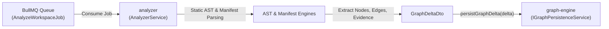

# Module Specification: `analyzer`

> **Module Name:** `analyzer`  
> **Architecture Layer:** Static Analysis & Relationship Extraction (Logical NestJS Module)  
> **Ownership:** Jointly-Maintained (AI updates progress checklists within approved scope; human approves structural contract changes)  
> **Status:** Specification Baseline (Phase 2)

---

## 1. Purpose & Responsibility

The `analyzer` module is responsible for analyzing ingested repository codebases, parsing configuration manifests, executing AST-based source code inspection, detecting API routes and controllers, ingesting OpenAPI specifications, and generating verifiable code evidence citations. It classifies discovered dependencies into deterministic observed facts vs. probabilistic inferred relationships and hands them off to `graph-engine` via an explicit persistence interface.

---

## 2. Scope & Non-Goals

### In-Scope (MVP):
- **Manifest & Configuration Analysis:**
  - Parse `package.json` for service identity, version, declared dependencies, dev dependencies, scripts, and workspaces.
  - Parse `docker-compose.yml` for multi-service container definitions, service names, port bindings, networks, and environment variables.
  - Parse `.env.example` and configuration files for database connection strings, message broker URLs, and external API base URLs.
- **AST-Based Source Code Analysis (TypeScript/JavaScript):**
  - Parse TypeScript and JavaScript source files using deterministic static AST parsers (e.g. Tree-sitter or Babel AST parser).
  - Extract package import/export declarations (`import ... from '...'`, `require('...')`).
  - Extract outbound SDK and client calls (HTTP client calls via Axios/Fetch, PostgreSQL/TypeORM/Prisma client invocations, Redis/BullMQ producer events).
- **API Route & Controller Detection:**
  - Detect backend HTTP controllers and route endpoints in NestJS (`@Controller`, `@Get`, `@Post`, `@Put`, `@Delete`, `@Patch`) and Express (`app.get`, `router.post`).
  - Extract route paths, HTTP verbs, handler method names, and controller classes.
- **OpenAPI / Swagger Ingestion:**
  - Parse static OpenAPI specifications (`openapi.yaml`, `openapi.json`, `swagger.json`) for endpoints, schemas, tags, and parameters.
  - Extract NestJS Swagger decorators (`@ApiTags`, `@ApiOperation`, `@ApiResponse`).
- **Classification of Facts vs. Inferred Relationships:**
  - **Evidence-Backed Observed Facts (`confidence: 1.0`, `isInferred: false`):** Deterministic relationships backed by explicit code evidence (package imports, manifests, Docker Compose networks, env var bindings). Rendered as verified components and solid edges.
  - **Inferred Relationships (`confidence < 1.0`, `isInferred: true`):** Probabilistic hypotheses (shared event topic names, semantic URL matches, naming heuristics). Must be explicitly labeled with confidence and **never presented or rendered as verified facts**.
- **Evidence Citation Generation:**
  - Generate an `EvidenceDto` for every discovered node and edge containing: `repositoryId`, `filePath`, `lineStart`, `lineEnd`, `codeSnippet`, and `commitSha`.
  - Enforce the **Exactly-One-Target Invariant**: each evidence record links strictly to either a `nodeId` OR an `edgeId` (`(node_id IS NOT NULL AND edge_id IS NULL) OR (node_id IS NULL AND edge_id IS NOT NULL)`).
- **Graph Engine Persistence Handoff:**
  - Deliver structured graph deltas to `graph-engine` via `IGraphPersistenceService`.

### Future Scope (Explicitly Excluded from MVP):
- Multi-language AST parsing (Python, Go, Java, Rust, C#).
- Dynamic runtime execution tracing, eBPF probes, and OpenTelemetry trace analysis.
- Live Kubernetes cluster state or Terraform cloud infrastructure drift detection.

### Explicit Non-Goals:
- Does **NOT** execute, run, or evaluate user code (`eval`, `new Function`, `vm`, `child_process` execution of scanned code is strictly banned).
- Does **NOT** handle user HTTP chat queries or call external LLM APIs (delegated to `intelligence-api`).
- Does **NOT** directly execute SQL queries against PostgreSQL tables (delegated to `graph-engine`).

---

## 3. Logical Interfaces & Persistence Data Flow



### Analyzer-to-Graph-Engine Persistence Contract:

The `analyzer` module communicates with `graph-engine` through an explicit TypeScript service interface:

```typescript
export type NodeType = 'SERVICE' | 'DATABASE' | 'QUEUE' | 'ENDPOINT' | 'PACKAGE';
export type EdgeType = 'CALLS' | 'READS_FROM' | 'WRITES_TO' | 'PRODUCES' | 'CONSUMES' | 'DEPENDS_ON';

export interface SystemNodeDto {
  readonly id: string; // deterministic UUID or hash
  readonly repositoryId: string;
  readonly name: string;
  readonly nodeType: NodeType;
  readonly metadata: Record<string, unknown>;
}

export interface SystemEdgeDto {
  readonly id: string;
  readonly sourceNodeId: string;
  readonly targetNodeId: string;
  readonly edgeType: EdgeType;
  readonly confidence: number; // 1.0 for deterministic, < 1.0 for inferred
  readonly isInferred: boolean; // true for heuristics; false for observed facts
  readonly metadata: Record<string, unknown>;
}

export interface EvidenceDto {
  readonly id: string;
  readonly nodeId?: string; // Set if node evidence, undefined if edge
  readonly edgeId?: string; // Set if edge evidence, undefined if node
  readonly repositoryId: string;
  readonly filePath: string;
  readonly lineStart: number;
  readonly lineEnd: number;
  readonly codeSnippet: string;
  readonly commitSha: string;
}

export interface GraphDeltaDto {
  readonly repositoryId: string;
  readonly commitSha: string;
  readonly nodes: readonly SystemNodeDto[];
  readonly edges: readonly SystemEdgeDto[];
  readonly evidence: readonly EvidenceDto[];
}

export interface PersistResultDto {
  readonly repositoryId: string;
  readonly commitSha: string;
  readonly nodesPersisted: number;
  readonly edgesPersisted: number;
  readonly evidencePersisted: number;
  readonly persistedAt: string;
}

/**
 * Public Persistence Interface exported by graph-engine and consumed by analyzer.
 */
export interface IGraphPersistenceService {
  persistGraphDelta(delta: GraphDeltaDto): Promise<PersistResultDto>;
}
```

---

## 4. Dependencies

- **Inbound Jobs:** Consumes BullMQ jobs dispatched by `ingestion`.
- **Outbound Targets:** `graph-engine` via `IGraphPersistenceService`.
- **Infrastructure Dependencies:**
  - Redis (proposed compatibility target: Redis 7+) for BullMQ job queue consumption.
  - Ephemeral scratch workspaces provisioned by `ingestion`.

---

## 5. Security & Invariant Rules

- **Zero Untrusted Code Execution:** Scanned code is treated as hostile input. Banned functions: `eval()`, `new Function()`, Node.js `vm` module, and `child_process.exec/spawn` targeting scanned repository code.
- **Evidence Integrity Invariant:** Every `EvidenceDto` must satisfy:
  `(nodeId !== undefined && edgeId === undefined) || (nodeId === undefined && edgeId !== undefined)`. Linking to both or neither is strictly invalid.
- **Resource Limits:**
  - Maximum AST traversal recursion depth: 50 levels (guards against deeply nested malicious AST bombs).
  - Per-file analysis timeout: 5 seconds.
  - Maximum file size: 1 MB.

---

## 6. Testing Expectations

- **Unit Tests:**
  - Manifest parsers: verify correct service and port extraction from `package.json` and `docker-compose.yml`.
  - Controller extractors: verify route extraction from NestJS `@Controller` and Express code snippets.
  - Evidence validator: verify that records violating the Exactly-One-Target invariant are rejected.
- **Golden-File Fixture Tests:**
  - Synthetic multi-repo fixtures under `test/fixtures/` parsed against snapshot golden JSON files (`topology.golden.json`).

---

## 7. Acceptance Criteria

1. **Deterministic Accuracy:** Extracts 100% of declared REST endpoints and Docker Compose services from valid fixtures with `confidence: 1.0` and `isInferred: false`.
2. **Inferred Labeling:** All probabilistic links are tagged with `isInferred: true` and `confidence < 1.0`, never presented as verified facts.
3. **Evidence Guarantee:** 100% of generated nodes and edges are linked to valid, verifiable evidence records with commit SHAs and line ranges.
4. **Single-Target Enforcement:** Zero evidence records contain both or neither `nodeId` / `edgeId`.
5. **Execution Safety:** Zero execution or evaluation of scanned source files.

---

## 8. Progress & Verification Tracking

- [ ] Manifest parser (`package.json`, `docker-compose.yml`, `.env.example`).
- [ ] TypeScript/JavaScript AST parser and import extractor.
- [ ] NestJS and Express route/controller extractor.
- [ ] OpenAPI / Swagger schema ingester.
- [ ] Fact vs. inferred relationship classifier.
- [ ] Evidence generator with Exactly-One-Target invariant validation.
- [ ] `IGraphPersistenceService` integration client.
- [ ] Golden-file fixture test suite.
