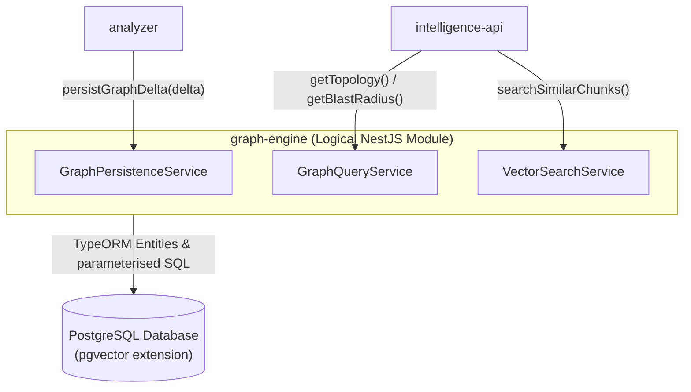

# Module Specification: `graph-engine`

> **Module Name:** `graph-engine`  
> **Architecture Layer:** Relational Graph Persistence & Blast-Radius Engine (Logical NestJS Module)  
> **Ownership:** Jointly-Maintained (AI updates progress checklists within approved scope; human approves structural contract changes)  
> **Status:** Specification Baseline (Phase 2) — ORM updated to TypeORM per human decision on 2026-10-13

---

## 1. Purpose & Responsibility

The `graph-engine` module is the central persistence and graph query authority for RepoDoctor. It manages the PostgreSQL relational system graph schema using TypeORM, enforces strict evidence integrity constraints, stores vector embeddings via `pgvector`, implements the receiving side of the analyzer persistence contract, and executes high-performance recursive Common Table Expression (CTE) graph traversals to calculate downstream blast radiuses.

---

## 2. Scope & Non-Goals

### In-Scope (MVP):
- **Relational Schema Management (TypeORM):**
  - Define and manage TypeORM entity classes: `RepositoryEntity`, `SystemNodeEntity`, `SystemEdgeEntity`, `EvidenceEntity`, and `CodeEmbeddingEntity`.
  - TypeORM migration files own schema evolution (`src/migrations/*.ts` in `backend`).
  - JSONB metadata columns on `SystemNodeEntity` and `SystemEdgeEntity` are declared with `@Column({ type: 'jsonb' })` for flexible storage of manifest and AST metadata.
- **Evidence Integrity Check Constraint:**
  - Enforce the **Exactly-One-Target Invariant** via a PostgreSQL table check constraint applied through TypeORM migration:
    ```sql
    ALTER TABLE evidence ADD CONSTRAINT chk_evidence_single_target
        CHECK (
            (node_id IS NOT NULL AND edge_id IS NULL) OR
            (node_id IS NULL AND edge_id IS NOT NULL)
        );
    ```
  - Applied via TypeORM migration raw SQL or the `@Check(...)` entity decorator. Migration must be reviewed by a human before execution.
- **Analyzer Persistence Service (`IGraphPersistenceService`):**
  - Implement atomic batch persistence of `GraphDeltaDto` payloads from `analyzer`.
  - Atomically upsert nodes, edges, and evidence for a specific Git commit SHA inside a single TypeORM database transaction (`queryRunner.startTransaction()` / `commitTransaction()` / `rollbackTransaction()`).
- **Directional Recursive CTE Traversals (Blast Radius):**
  - Provide downstream blast-radius traversals starting from any modified node or file.
  - Implemented using explicit, parameterised SQL via `DataSource.query(sql, params)` — TypeORM does not provide a query builder abstraction for `WITH RECURSIVE` CTE queries.
  - Robust cycle detection using a path tracking array (`visited` array) to prevent infinite loops on circular dependencies.
  - Performance target: sub-50ms query time for 1,000-node topologies (design hypothesis to be empirically validated during Milestone 6 benchmarks).
- **Vector Embeddings Storage & Similarity Retrieval:**
  - Store text chunk embeddings alongside model identity metadata (`model_provider`, `model_name`, `embedding_config_revision`, `dimension`).
  - Support top-k cosine similarity queries (`<=>` operator) with bounded query limits (`k <= 50`) via explicit parameterised SQL (`DataSource.query(sql, [vectorLiteral, k])`).
  - **[OPEN QUESTION — Unresolved before Milestone 2]:** TypeORM does not natively support the `vector(n)` column type from the `pgvector` extension. Options under evaluation: (a) `pgvector/typeorm` adapter package (compatibility with Node.js 22 LTS and TypeORM 0.3.x must be confirmed), or (b) a custom `@Column()` type declaration mapping the column to the PostgreSQL `vector` type with application-level float array serialisation. Resolution required before schema migration is authored.
- **Commit Immutability & Versioning:**
  - System graph topology is tied to Git commit SHAs. Extracted graphs for a specific commit SHA are immutable.

### Explicit Non-Goals:
- Does **NOT** execute LLM inference or synthesize natural-language answers (delegated to `intelligence-api`).
- Does **NOT** communicate with external GitHub APIs or access local source files (delegated to `ingestion` and `analyzer`).
- Does **NOT** perform client-side rendering (delegated to `web-client`).

---

## 3. Logical Interfaces & Persistence Data Flow



### Query Mechanism Summary:

| Operation | Mechanism | SQL Ownership |
| :--- | :--- | :--- |
| Entity CRUD (nodes, edges, evidence) | TypeORM `Repository<Entity>` / `QueryBuilder` | ORM-managed |
| Transaction (delta persist) | TypeORM `queryRunner` + `startTransaction()` | ORM-managed |
| JSONB metadata read/write | TypeORM `@Column({ type: 'jsonb' })` | ORM-managed |
| Recursive CTE blast-radius | `DataSource.query(sql, params)` — explicit SQL | Human-reviewed SQL |
| pgvector similarity search | `DataSource.query(sql, [vecLiteral, k])` — explicit SQL | Human-reviewed SQL |
| Check constraint creation | TypeORM migration raw `ALTER TABLE` or `@Check()` | Human-reviewed migration |

### Public TypeScript Contracts & DTOs (unchanged):

```typescript
export interface GraphTopologyDto {
  readonly repositoryId: string;
  readonly commitSha: string;
  readonly nodes: readonly SystemNodeDto[];
  readonly edges: readonly SystemEdgeDto[];
  readonly totalNodes: number;
  readonly totalEdges: number;
}

export interface BlastRadiusNodeDto {
  readonly nodeId: string;
  readonly name: string;
  readonly nodeType: NodeType;
  readonly depth: number;
  readonly path: readonly string[]; // chain of dependency edge IDs
}

export interface BlastRadiusResultDto {
  readonly rootNodeId: string;
  readonly affectedNodes: readonly BlastRadiusNodeDto[];
  readonly totalAffectedServices: number;
  readonly maxDepth: number;
}

export interface VectorSearchResultDto {
  readonly id: string;
  readonly nodeId: string;
  readonly contentChunk: string;
  readonly similarityScore: number;
  readonly metadata: Record<string, unknown>;
}

/**
 * Public Graph Query Interface exported by graph-engine and consumed by intelligence-api.
 */
export interface IGraphQueryService {
  getTopology(repositoryId: string, commitSha?: string): Promise<GraphTopologyDto>;
  getDownstreamBlastRadius(nodeId: string, maxDepth?: number): Promise<BlastRadiusResultDto>;
  searchCodeEmbeddings(queryVector: readonly number[], topK?: number): Promise<readonly VectorSearchResultDto[]>;
}
```

---

## 4. Dependencies

- **Inbound Consumers:** `analyzer` (via `IGraphPersistenceService`), `intelligence-api` (via `IGraphQueryService`).
- **Outbound Targets:** None within application code (data tier leaf).
- **Infrastructure Dependencies:**
  - PostgreSQL (proposed compatibility target: PostgreSQL 16+) with `pgvector` extension.
  - TypeORM (`typeorm`, `@nestjs/typeorm`, `pg`) for entity management and migrations.
  - Redis (proposed compatibility target: Redis 7+) for caching topology payloads.

---

## 5. Security & Invariant Rules

- **Strict Parameterised Queries Always:** 100% of database interactions must use TypeORM entity repositories, query builders, or the parameterised `DataSource.query(sql, params)` form. Raw string interpolation or template literal SQL is strictly forbidden.
- **Evidence Integrity Invariant:** Rejects any insert or update on `evidence` where both `node_id` and `edge_id` are set, or where both are null (`chk_evidence_single_target`).
- **Vector Query Bounds:** Top-k parameters are bounded to `k <= 50` to prevent denial-of-service on vector similarity calculations.
- **Transaction Isolation:** Ingestion of graph deltas must be wrapped in atomic TypeORM transactions to ensure that partial failures never leave orphaned nodes or dangling edges.

---

## 6. Testing Expectations

- **Unit Tests:**
  - TypeORM query builder tests verifying entity column mappings and parameterised query outputs.
  - Cycle detection unit test verifying termination on cyclic DAG test fixtures.
- **Integration Tests (PostgreSQL Docker Container):**
  - Database constraint test: verify that violating `chk_evidence_single_target` throws a PostgreSQL check constraint error (`23514`).
  - Transaction rollback test: verify that a failed edge insert rolls back associated node inserts cleanly.
  - Recursive CTE traversal test: assert correct downstream reachability and depth on a known multi-service graph.
  - pgvector integration test: verify that embedding insert and similarity search return correctly ordered results.

---

## 7. Acceptance Criteria

1. **Integrity Enforcement:** 100% of persisted evidence records link to exactly one target; violations fail with check constraint error code `23514`.
2. **Cycle Resilience:** Recursive CTE query terminates cleanly on cyclic dependency graphs without infinite recursion.
3. **Immutability:** Graph queries for a specific commit SHA return deterministic, identical results across successive queries.
4. **Injection Immunity:** Zero occurrences of raw string concatenation in SQL queries across the entire codebase. All `DataSource.query()` calls use parameterised form.

---

## 8. Progress & Verification Tracking

- [ ] TypeORM entity definitions (`RepositoryEntity`, `SystemNodeEntity`, `SystemEdgeEntity`, `EvidenceEntity`, `CodeEmbeddingEntity`).
- [ ] PostgreSQL schema migration files and `chk_evidence_single_target` check constraint migration.
- [ ] Resolve pgvector column type strategy for TypeORM (`pgvector/typeorm` adapter vs. custom column type).
- [ ] `GraphPersistenceService` implementation with TypeORM atomic transactions.
- [ ] Recursive CTE blast-radius traversal query with cycle detection (explicit parameterised SQL via `DataSource.query`).
- [ ] pgvector similarity search query (explicit parameterised SQL via `DataSource.query`).
- [ ] Integration test suite running against PostgreSQL Docker container.
