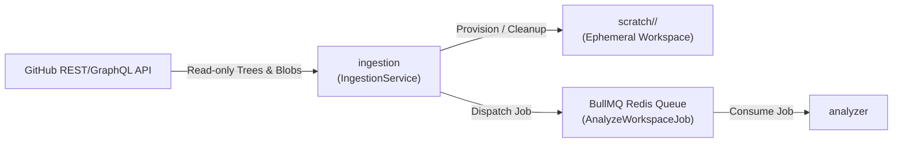

# Module Specification: `ingestion`

> **Module Name:** `ingestion`  
> **Architecture Layer:** Backend Ingestion & Workspace Isolation (Logical NestJS Module)  
> **Ownership:** Jointly-Maintained (AI updates progress checklists within approved scope; human approves structural contract changes)  
> **Status:** Specification Baseline (Phase 2)

---

## 1. Purpose & Responsibility

The `ingestion` module is responsible for secure, authenticated, read-only ingestion of multi-repository source code and metadata across configured GitHub repositories. It provisions isolated, ephemeral scratch workspaces for downstream static analysis, computes SHA-256 content hashes to detect changes, and dispatches asynchronous analysis jobs to the queue.

---

## 2. Scope & Non-Goals

### In-Scope (MVP):
- **GitHub App Authentication:** Authenticate via short-lived GitHub App installation access tokens (< 1 hour duration).
- **Metadata Ingestion:** Fetch repository metadata, default branches, tree listings, and Git commit SHAs.
- **Selective File Streaming & Shallow Fetching:** Fetch manifests (`package.json`, `docker-compose.yml`, `.env.example`), configuration files, and source code files on demand or via shallow git operations.
- **SHA-256 Change Detection:** Compute content hashes of scanned files to skip re-analyzing unchanged files across successive commits.
- **Workspace Isolation & Lifecycle Management:** Create isolated temporary scratch workspaces (`scratch/<jobId>/`) for repository analysis, ensuring guaranteed cleanup upon job completion or failure.
- **Asynchronous Job Dispatch:** Enqueue `AnalyzeWorkspaceJob` onto BullMQ with repository metadata and isolated directory paths.

### Explicit Non-Goals:
- Does **NOT** perform AST parsing, code tokenization, or relationship extraction (delegated to `analyzer`).
- Does **NOT** request or accept write, administration, or workflow permissions on GitHub (strictly read-only).
- Does **NOT** execute user code, installation scripts (`npm install`), build tools, or repository git hooks.
- Does **NOT** write directly to primary PostgreSQL graph tables (delegated to `graph-engine`).
- Does **NOT** manage multi-tenant billing or user account management.

---

## 3. Logical Interfaces & Data Flow



### Public TypeScript Contracts & DTOs:

```typescript
export interface IngestRepositoryDto {
  readonly installationId: number;
  readonly repositoryOwner: string;
  readonly repositoryName: string;
  readonly ref?: string; // branch or commit SHA (defaults to default branch)
}

export interface WorkspaceMetadataDto {
  readonly jobId: string;
  readonly repositoryId: string;
  readonly commitSha: string;
  readonly workspacePath: string;
  readonly fileCount: number;
  readonly totalSizeBytes: number;
}

export interface IngestionJobPayload {
  readonly jobId: string;
  readonly repositoryId: string;
  readonly commitSha: string;
  readonly workspacePath: string;
  readonly manifestFiles: readonly string[];
  readonly sourceFiles: readonly string[];
  readonly enqueuedAt: string;
}

export interface IIngestionService {
  ingestRepository(dto: IngestRepositoryDto): Promise<WorkspaceMetadataDto>;
  cleanupWorkspace(jobId: string): Promise<void>;
}
```

---

## 4. Dependencies

- **Internal Dependencies:** None (upstream leaf in backend dependency flow).
- **Outbound Targets:** Dispatches BullMQ jobs to `analyzer`.
- **Infrastructure Dependencies:**
  - GitHub REST & GraphQL API (Read-Only scopes).
  - Redis (proposed compatibility target: Redis 7+) via `@nestjs/bullmq` for asynchronous job management.
  - Local host filesystem for isolated scratch workspaces (`scratch/`).

---

## 5. Security & Isolation Safeguards

- **Strict Read-Only GitHub Permission Guarantee:** Only request `contents:read`, `pull_requests:read`, `issues:read`, and `metadata:read`. Write requests are strictly banned.
- **Token Hygiene & Lifecycle:** Installation access tokens are ephemeral (< 1 hr), never stored in database tables, never logged, and never included in error stack traces.
- **Zero Untrusted Code Execution:** Scanned code is strictly untrusted data. No repository files may be executed, spawned, evaluated, or imported. Repository scripts (`package.json` scripts, hooks) are never executed.
- **Workspace Sandboxing & Guaranteed Cleanup:**
  - Ephemeral scratch workspaces are created in an isolated scratch path.
  - Explicit lifecycle cleanup hooks (`finally` blocks and queue failure listeners) guarantee directory deletion regardless of job outcome.
- **Resource Limits & DoS Prevention:**
  - Maximum repository size cap: 500 MB.
  - Maximum individual file size cap: 1 MB (files exceeding this are skipped with a warning).
  - Ingestion job timeout: 10 minutes.

---

## 6. Testing Expectations

- **Unit Tests:**
  - Mocked GitHub API responses verifying token generation and header configuration.
  - SHA-256 hash calculation and cache-hit detection on synthetic directory structures.
  - Path traversal defense: ensure malicious file paths (e.g. `../../etc/passwd`) are rejected.
- **Integration Tests:**
  - Workspace lifecycle tests: verify scratch directories are created, populated with mock files, and completely removed on both success and simulated failure.
  - BullMQ job dispatch test: verify payload structure matching `IngestionJobPayload`.

---

## 7. Acceptance Criteria

1. **Security:** GitHub App requests fail immediately if write scopes are present.
2. **Isolation:** Cloned/streamed files are never executed and cannot escape the temporary scratch directory.
3. **Traceability:** Every ingested file record includes the verbatim Git commit SHA.
4. **Cleanup:** Zero orphan scratch directories remain after job completion or termination.
5. **Limits:** Files exceeding 1 MB are skipped with structured log entries without crashing the job.

---

## 8. Progress & Verification Tracking

- [ ] GitHub App authentication service and token caching (< 1 hr).
- [ ] Tree fetching and SHA-256 content hasher.
- [ ] Ephemeral scratch workspace manager with guaranteed lifecycle cleanup.
- [ ] Resource limiter (file size, repo size, job timeouts).
- [ ] BullMQ job dispatcher and queue event listeners.
- [ ] Unit and integration test suite passing with empirical proof.
