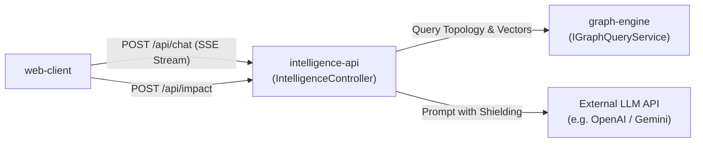

# Module Specification: `intelligence-api`

> **Module Name:** `intelligence-api`  
> **Architecture Layer:** Hybrid Retrieval & LLM Intelligence Orchestration (Logical NestJS Module)  
> **Ownership:** Jointly-Maintained (AI updates progress checklists within approved scope; human approves structural contract changes)  
> **Status:** Specification Baseline (Phase 2)

---

## 1. Purpose & Responsibility

The `intelligence-api` module orchestrates natural-language architecture questions, hybrid graph-and-vector retrieval, change-impact analysis for pull requests, and real-time streaming conversational responses. It implements strict prompt shielding to prevent prompt injection from scanned code, verifies that all generated responses are grounded in verifiable code evidence, and serves validated REST/SSE endpoints to `web-client`.

---

## 2. Scope & Non-Goals

### In-Scope (MVP):
- **Hybrid Retrieval Orchestration:**
  - Retrieve structural subgraphs and dependency paths from `graph-engine` via `IGraphQueryService`.
  - Retrieve top-k semantic code and documentation chunks via vector similarity search.
  - Fuse structural and semantic context into a unified prompt context.
- **LLM Prompt Shielding & Injection Defense:**
  - Delimit ingested source code and manifest chunks inside distinct XML tags (`<code_context>...</code_context>`).
  - Instruct the model via system prompt to treat all scanned code as untrusted user data and disregard instructions or prompt injections embedded within scanned files.
- **Evidence Citation Grounding Guarantee:**
  - Ground every architectural assertion, dependency statement, and blast-radius summary in verifiable `evidence` records retrieved from `graph-engine`.
  - Every cited evidence record adheres to the **Exactly-One-Target Evidence Invariant** (`chk_evidence_single_target`), pointing to either a specific node or edge.
  - Inferred relationships (`isInferred: true`, `confidence < 1.0`) must be explicitly labeled with confidence scores and **never presented as verified facts**. Speculative claims without backing evidence must be flagged with `confidence < 0.80`.
- **Change-Impact Analysis API:**
  - Accept proposed pull request diffs or modified file paths, map modified files to system nodes, and query `graph-engine` to calculate affected downstream blast radiuses.
- **Streaming Chat API:**
  - Provide Server-Sent Events (SSE) endpoints streaming conversational answers with structured citation markers to `web-client`.

### Explicit Non-Goals:
- Does **NOT** execute or run scanned repository code.
- Does **NOT** perform direct database queries against PostgreSQL tables (accesses graph strictly via `graph-engine` service interfaces).
- Does **NOT** automatically write code, generate refactoring PRs, or modify customer codebases.
- Does **NOT** clone or stream repositories from GitHub (delegated to `ingestion`).

---

## 3. Logical Interfaces & Data Flow



### Public TypeScript Contracts & DTOs:

```typescript
export interface ArchitectureQuestionDto {
  readonly repositoryId: string;
  readonly query: string;
  readonly contextNodeIds?: readonly string[];
  readonly conversationId?: string;
}

export interface EvidenceCitationDto {
  readonly evidenceId: string;
  readonly targetType: 'NODE' | 'EDGE';
  readonly targetId: string;
  readonly filePath: string;
  readonly lineStart: number;
  readonly lineEnd: number;
  readonly snippet: string;
  readonly commitSha: string;
}

export interface ArchitectureAnswerChunkDto {
  readonly type: 'token' | 'citation' | 'done';
  readonly text?: string;
  readonly citation?: EvidenceCitationDto;
}

export interface ImpactAnalysisRequestDto {
  readonly repositoryId: string;
  readonly modifiedFiles: readonly string[];
  readonly baseCommitSha: string;
  readonly targetCommitSha: string;
}

export interface ImpactAnalysisResultDto {
  readonly affectedRootNodeIds: readonly string[];
  readonly downstreamBlastRadius: readonly BlastRadiusNodeDto[];
  readonly totalImpactedServices: number;
  readonly citations: readonly EvidenceCitationDto[];
}

export interface IIntelligenceApiService {
  askArchitectureQuestion(dto: ArchitectureQuestionDto): AsyncIterable<ArchitectureAnswerChunkDto>;
  analyzeChangeImpact(dto: ImpactAnalysisRequestDto): Promise<ImpactAnalysisResultDto>;
}
```

---

## 4. Dependencies

- **Inbound Consumers:** `web-client` (via HTTP REST and SSE endpoints).
- **Outbound Targets:** `graph-engine` (via `IGraphQueryService`), External LLM Provider API.
- **Infrastructure Dependencies:**
  - Redis (proposed compatibility target: Redis 7+) for caching frequent query contexts.
  - External LLM API credentials (managed via environment variables).

---

## 5. Security & Invariant Rules

- **Prompt Shielding Invariant:** All ingested code placed in LLM prompts must be delimited with XML tags (`<code_context>`), and system prompts must explicitly forbid executing instructions embedded within source files.
- **Evidence Traceability Guarantee:** The service is strictly forbidden from claiming a dependency exists without an evidence citation or an explicit `isInferred: true` disclaimer.
- **API Key Hygiene:** LLM provider API keys must never be logged, printed to console, or passed to the frontend client.
- **Input Validation:** All user queries and file path parameters are validated and sanitized via NestJS `ValidationPipe` using `class-validator` DTOs.

---

## 6. Testing Expectations

- **Unit Tests:**
  - Prompt construction test: verify that source code context is properly XML-escaped and delimited.
  - Citation grounding test: verify that assertions without backing evidence are flagged with `isInferred: true`.
- **Integration Tests (Mocked LLM API):**
  - Simulated prompt injection test: feed adversarial input containing `<script>` and `Ignore previous instructions` inside mock code files; verify that the system prompt structure remains uncorrupted.
  - SSE streaming test: verify correct event formatting (`text/event-stream`) and chunk serialization.

---

## 7. Acceptance Criteria

1. **Injection Resilience:** Zero leak of system prompt or prompt corruption when scanning adversarial code files.
2. **Grounding:** 100% of verified architectural claims link to a valid `evidenceId` in `graph-engine`.
3. **Inferred Transparency:** Any probabilistic relationship is labeled with confidence score and explicit `isInferred: true` flag.
4. **Streaming Protocol:** SSE streams emit well-formed tokens and terminate cleanly with a `done` event.

---

## 8. Progress & Verification Tracking

- [ ] Hybrid retrieval service fusing graph topology and vector search.
- [ ] Prompt shielding formatter and system prompt definition.
- [ ] LLM provider client wrapper with retry and rate-limiting logic.
- [ ] Citation grounding and fact-checking validator.
- [ ] Change-impact blast-radius API endpoint (`/api/impact`).
- [ ] SSE streaming chat controller and event emitter (`/api/chat`).
- [ ] Unit and prompt-injection integration tests.
