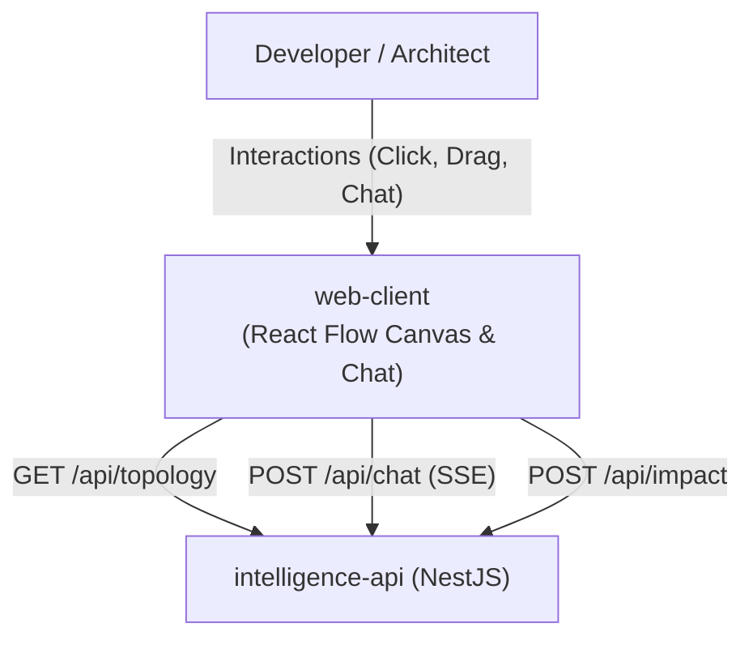

# Module Specification: `web-client`

> **Module Name:** `web-client`  
> **Architecture Layer:** Frontend Presentation & Interactive Canvas (Next.js App Router)  
> **Ownership:** Jointly-Maintained (AI updates progress checklists within approved scope; human approves structural contract changes)  
> **Status:** Specification Baseline (Phase 2)

---

## 1. Purpose & Responsibility

The `web-client` module is the user-facing web interface for RepoDoctor. It provides an interactive node-edge dependency canvas using React Flow, sliding inspection drawers for component metadata and code evidence snippets, visual downstream blast-radius highlighting, and an integrated natural-language architecture chat drawer.

---

## 2. Scope & Non-Goals

### In-Scope (MVP):
- **React Flow Dynamic Canvas:**
  - Client-side dynamic import (`next/dynamic` with `ssr: false`) to eliminate server-side hydration mismatches.
  - Custom React Flow node components for system components: Services, Databases, Queues, and Endpoints.
  - Directional edges indicating typed dependencies (Calls, Reads, Writes, Produces, Consumes).
  - **Visual Distinction for Facts vs. Inferred Relationships:** Deterministic relationships render as **solid lines**; inferred relationships render as **dashed lines with confidence badges** and are never presented as verified facts.
- **Node & Edge Detail Inspector:**
  - Sliding side-drawer showing metadata, technology tags, inbound/outbound dependencies, and linked code evidence citations.
  - Verbatim code snippet viewer displaying file path, commit SHA, and line numbers.
- **Interactive Blast-Radius Highlighting:**
  - Visual mode highlighting affected downstream components and dimming unaffected nodes when an upstream service or PR diff is inspected.
- **Architecture Chat Drawer:**
  - Chat interface consuming SSE streaming tokens from `intelligence-api`.
  - Clickable citation badges in chat responses that center and zoom the React Flow canvas to the cited component.
- **URL-Driven Navigation State:**
  - Selected nodes, active view modes, and search query filters reflected in URL search parameters.

### Explicit Non-Goals:
- Does **NOT** execute graph traversal algorithms on the client (computed server-side by `graph-engine`).
- Does **NOT** query PostgreSQL directly or run database migrations (accesses backend via REST/SSE endpoints).
- Does **NOT** access GitHub APIs or local repositories directly.

---

## 3. Logical Interfaces & Data Flow



### Component Architecture:

```typescript
// Client-side visual state models
export interface CanvasNodeData {
  readonly id: string;
  readonly name: string;
  readonly nodeType: 'SERVICE' | 'DATABASE' | 'QUEUE' | 'ENDPOINT' | 'PACKAGE';
  readonly isHighlighted: boolean;
  readonly metadata: Record<string, unknown>;
}

export interface CanvasEdgeData {
  readonly id: string;
  readonly source: string;
  readonly target: string;
  readonly edgeType: string;
  readonly confidence: number;
  readonly isInferred: boolean; // Determines solid (false) vs dashed (true) line style
}

export interface SelectedComponentState {
  readonly selectedNodeId?: string;
  readonly selectedEdgeId?: string;
  readonly activeEvidenceList: readonly EvidenceCitationDto[];
}
```

---

## 4. Dependencies

- **Inbound Consumers:** End-user web browser.
- **Outbound Targets:** Backend HTTP REST and SSE streaming endpoints exposed by `intelligence-api`.
- **Frontend Stack:** Next.js (App Router), React, React Flow, Tailwind CSS, TypeScript.

---

## 5. Security & Isolation Rules

- **Zero Client Credentials:** Database connection strings, GitHub App private keys, and LLM API keys must **NEVER** be imported into client components or exposed in Next.js public environment variables (`NEXT_PUBLIC_*`).
- **XSS Sanitization:** Code snippets and markdown rendered in chat drawers and evidence viewers must be sanitized against script injection attacks.
- **Client-Side Validation:** All user inputs in the chat drawer are validated and trimmed before dispatching requests.

---

## 6. Testing Expectations

- **Component Tests (React Testing Library):**
  - Custom node rendering: assert correct styling and badge rendering for Services, Databases, Queues, and Endpoints.
  - Edge styling test: verify that `isInferred: true` renders dashed edge styling and confidence indicators.
  - Evidence viewer test: verify that code snippet blocks correctly render file path, commit SHA, and line numbers.
- **End-to-End Flow Tests (Playwright / Cypress):**
  - Verify canvas loads without SSR hydration errors.
  - Verify clicking an evidence citation badge in the chat drawer triggers canvas zoom and focus.

---

## 7. Acceptance Criteria

1. **Hydration Safety:** Zero React hydration warnings or mismatches on page load.
2. **Visual Truthfulness:** Inferred edges render dashed with explicit confidence percentages; deterministic edges render solid. Inferred relationships are never presented as verified facts.
3. **Evidence Interactivity:** Clicking an evidence citation badge centers the canvas on the cited node and opens the evidence snippet viewer.
4. **Credential Isolation:** Client bundles contain zero private environment variables or secrets.

---

## 8. Progress & Verification Tracking

- [ ] Dynamic React Flow canvas wrapper (`next/dynamic` with `ssr: false`).
- [ ] Custom node cards (Service, Database, Queue, Endpoint).
- [ ] Custom edge renderers (solid for deterministic, dashed for inferred).
- [ ] Sliding detail drawer for node/edge metadata.
- [ ] Evidence snippet viewer with line highlighting.
- [ ] SSE streaming chat interface with citation links.
- [ ] Downstream blast-radius visual dimmer.
- [ ] Component test suite.
