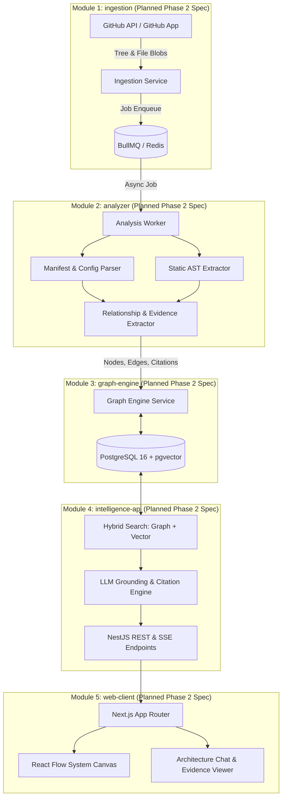
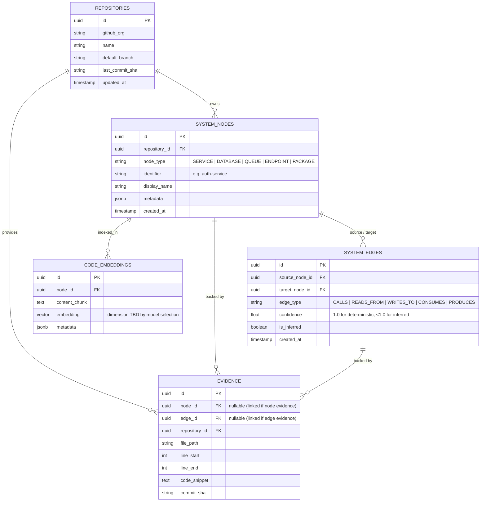

# System Architecture & Component Design — RepoDoctor

> **Authority:** Canonical Architectural Baseline  
> **Precedence:** Level 4 (Governs all module implementations and interfaces)

---

## 1. High-Level System Architecture

RepoDoctor is structured around a unidirectional pipeline that transforms raw multi-repository code and manifests into an evidence-backed system intelligence graph.

> [!NOTE]
> Detailed interface contracts for each module will be defined in `docs/modules/*/MODULE.md` during Phase 2.



---

## 2. Core Relational Data Model (PostgreSQL + pgvector)

The graph is persisted relationally with foreign-key constraints to guarantee integrity across re-indexing operations. Every node and every edge is backed by verifiable line citations in code or manifests:



### 2.1 Evidence Integrity Invariant (Data-Integrity Rule)

To guarantee unambiguous provenance and prevent conflicting citations, every `evidence` record must satisfy this strict invariant:

> [!IMPORTANT]
> **Exactly-One-Target Invariant:**  
> Each evidence record must reference **exactly one target**: either a `system_node` OR a `system_edge`.  
> An evidence record must never link to both a node and an edge simultaneously, nor may it link to neither.

When the database schema is established during Phase 3, this invariant will be enforced via a PostgreSQL table check constraint:
```sql
ALTER TABLE evidence ADD CONSTRAINT chk_evidence_single_target
    CHECK (
        (node_id IS NOT NULL AND edge_id IS NULL) OR
        (node_id IS NULL AND edge_id IS NOT NULL)
    );
```
- **Node Evidence (`node_id IS NOT NULL`):** Proves the existence, configuration, and declaration of a system node (e.g. service manifest in `docker-compose.yml:L12-L28`, database connection string in `config.ts:L40-L45`).
- **Edge Evidence (`edge_id IS NOT NULL`):** Proves an active directional dependency or data flow between two nodes (e.g. an HTTP client call, message producer publish, or consumer handler).

---

## 3. Directional Blast-Radius Traversal (PostgreSQL Recursive CTE)

When a developer or AI agent asks for the impact of modifying a component, `graph-engine` executes a recursive traversal:

> [!TIP]
> **Performance Target:** Target sub-50ms graph traversal latency for 1,000-node systems. This is a design hypothesis to be validated through empirical benchmarks once test fixtures and Docker database containers are initialized.

```sql
WITH RECURSIVE blast_radius AS (
    -- Anchor member: immediate downstream dependents
    SELECT 
        e.id AS edge_id,
        e.source_node_id,
        e.target_node_id,
        e.edge_type,
        e.confidence,
        1 AS depth,
        ARRAY[e.source_node_id, e.target_node_id] AS path
    FROM system_edges e
    WHERE e.source_node_id = :targetNodeId

    UNION ALL

    -- Recursive member: follow outgoing edges with cycle prevention
    SELECT 
        e.id AS edge_id,
        e.source_node_id,
        e.target_node_id,
        e.edge_type,
        e.confidence,
        b.depth + 1,
        b.path || e.target_node_id
    FROM system_edges e
    JOIN blast_radius b ON e.source_node_id = b.target_node_id
    WHERE NOT (e.target_node_id = ANY(b.path)) -- Cycle prevention
      AND b.depth < 10                         -- Max traversal depth
)
SELECT 
    b.*, 
    n.display_name AS target_node_name, 
    n.node_type AS target_node_type
FROM blast_radius b
JOIN system_nodes n ON b.target_node_id = n.id
ORDER BY b.depth ASC;
```

---

## 4. Hybrid Search & Grounded Retrieval Flow

To answer architectural questions (*"How does user signup communicate with the email notification system?"*):
1. **Semantic Search (`pgvector`):** Vector similarity search identifies relevant nodes, endpoints, and code chunks. (Embedding model and vector dimensions to be finalized upon model selection).
2. **Relational Subgraph Expansion:** Using the top-k matched nodes, the graph engine retrieves immediate neighbors (1-hop or 2-hop edges) and associated evidence.
3. **Prompt Construction:** The retrieved subgraph topology and code citations are packaged into an evidence context block for the LLM.
4. **Citation Enforcement:** The response generator parses the LLM output and validates that every cited relation maps to an active record in `system_edges` and `evidence`. Any ungrounded claim is stripped or flagged with a warning badge.
